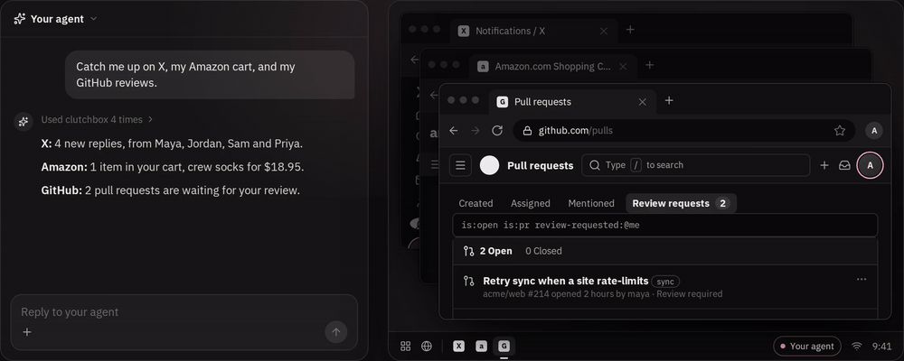

<div align="center">
  <a href="https://www.clutchbox.dev">
    
  </a>

  <p>
    <a href="LICENSE"></a>
    <a href="https://github.com/clutchbox-hq/clutchbox/actions/workflows/ci.yml"></a>
    <a href="https://github.com/clutchbox-hq/clutchbox/releases/latest"></a>
  </p>

  <p>
    <a href="https://www.clutchbox.dev">Website</a>
    ·
    <a href="https://chromewebstore.google.com/detail/agent-computers-%E2%80%94-browser/bjmfpnkjkdkfimdfgbgepmdgdnodpmmi">Chrome extension</a>
    ·
    <a href="#self-host">Self-host</a>
    ·
    <a href="SECURITY.md">Security</a>
    ·
    <a href="https://github.com/clutchbox-hq/clutchbox/issues">Issues</a>
  </p>
</div>

**Your agents, already signed in.** You choose the sites, and every agent session opens signed in as you: no passwords typed, no 2FA prompts, no cookie files going stale.

A Chrome extension keeps the sign-ins for the sites you pick in sync, one way, to where your agents run: a hosted computer with Chrome, or your own Playwright, browser-use, Stagehand, or any Chrome over CDP. All of it is open source under Apache-2.0, and you can run the whole product yourself.

## Same sign-ins, two ways in

**For you: your assistant, signed in as you.**

1. Add the [extension](https://chromewebstore.google.com/detail/agent-computers-%E2%80%94-browser/bjmfpnkjkdkfimdfgbgepmdgdnodpmmi) and pick your sites.
2. Connect Claude, ChatGPT, Claude Code, or Codex at [clutchbox.dev](https://www.clutchbox.dev).
3. Ask. It starts signed in, on a fresh computer you can watch live and take over.

**For your users: your app, signed in as each user.**

1. Your user connects once, and joining your organization is their consent.
2. Open a session for them with the [SDK](packages/sdk#readme).
3. Drive it with Playwright or any CDP client.

```ts
const clutchbox = createClient({ server: 'https://www.clutchbox.dev', apiKey });
const session = await clutchbox.computers.open({ member: user.id });

const browser = await chromium.connectOverCDP(session.cdpUrl);
const page = await browser.contexts()[0].newPage();
await page.goto('https://github.com'); // signed in as them
```

To use your own browsers instead, read a user's latest sign-ins and apply them with a runtime adapter, in one call:

| Where the agent's browser runs | Runtime adapter |
| --- | --- |
| Any Chrome over CDP | [`@clutchbox/apply`](packages/apply) |
| Playwright, browser-use, Stagehand | [`@clutchbox/playwright`](packages/playwright) |
| An [E2B](https://e2b.dev) sandbox | [`@clutchbox/runtime-e2b`](packages/runtime-e2b) |
| An [Instabox](https://instabox.sh) sandbox | [`@clutchbox/runtime-instabox`](packages/runtime-instabox) |
| A [Boat](https://boat.dev) sandbox | [`@clutchbox/runtime-boat`](packages/runtime-boat) |

## How it works

1. **Capture.** The extension reads cookies only for the sites you add, each behind its own Chrome permission, and uploads a new capture when one changes.
2. **Store.** The server keeps the latest capture encrypted at rest and serves it only to the agents you connect.
3. **Apply.** The agent's browser gets the newest sign-ins: only what changed is written, sites you signed out of are cleared, and every other site is left alone.

## Security

Sync goes one way: agents work on copies, and nothing they do reaches your browser.

- **Opt in, site by site.** No host permissions at install; Chrome asks for each site you add.
- **Cookies, not passwords.** Passwords, passkeys, and 2FA secrets never leave your browser.
- **Off in one click.** Pause, remove a site, or disconnect, which deletes what that browser uploaded.
- **Sealed at rest.** AES-256-GCM, under a key kept outside the database.

Whoever runs the server and the agent's browser can use the synced sessions, and some sites tie sign-ins to your device. [SECURITY.md](SECURITY.md) has the full model and how to report a vulnerability.

## Self-host

The [web app](apps/web#readme) is the whole product for one organization: sign-in, browser sync, a computer per member on your own [E2B](https://e2b.dev) team with live view and takeover, and the MCP server agents connect to. With Docker and an [E2B API key](https://e2b.dev/dashboard?tab=keys):

```sh
git clone https://github.com/clutchbox-hq/clutchbox && cd clutchbox
cat > .env <<EOF
BETTER_AUTH_SECRET=$(openssl rand -base64 32)
CAPTURE_ENCRYPTION_KEY=$(openssl rand -base64 32)
E2B_API_KEY=e2b_your_key
SMTP_URL=smtp://mailpit:1025
SMTP_FROM=agents@localhost
EOF
docker compose up --build
```

Then sign in at <http://localhost:3000>, with the link from Mailpit at <http://localhost:8025>. The [web app's README](apps/web#readme) covers connecting the extension and agents, running on a server, sign-in providers, your own computer template, and extending it without a fork.

## How it compares

| | Clutchbox | Cloud browser profiles (Browserbase, Kernel) | Exported cookie files | Giving the agent your password |
| --- | --- | --- | --- | --- |
| Uses the sessions you already have | ✅ | Sign in again in their browser | ✅ | Agent signs in |
| Stays current | Syncs in the background | Until the session expires | One-off snapshot | Per sign-in |
| Works across providers | Any Chrome over CDP | That provider | By hand | ✅ |
| Password reaches the agent | No | Typed into their browser | No | Yes |
| Consent and revoke | Per site, one click | Per profile | None | Change your password |

## Packages

| Package | What it does |
| --- | --- |
| [`apps/extension`](apps/extension) | The Chrome extension (Manifest V3) that captures the sites you authorize and syncs them to your server. |
| [`apps/web`](apps/web) | The web app for one organization: the dashboard, sign-in, the API, and MCP. [`Dockerfile`](Dockerfile) and [`compose.yaml`](compose.yaml) run it with Postgres, the API in its own container behind Caddy. |
| [`packages/cli`](packages/cli) | `npx clutchbox`: connects Claude Code and Codex to a Clutchbox server and opens setup. |
| [`packages/sdk`](packages/sdk) | The TypeScript SDK for the developer REST API: members' latest captures, and computer sessions driven over CDP. |
| [`packages/playwright`](packages/playwright) | Applies a capture to a Playwright browser context, a persistent context, or a Chrome attached over CDP. |
| [`packages/apply`](packages/apply) | Works out what a capture changes since the last one applied, and applies it to any Chrome over CDP. |
| [`packages/runtime-e2b`](packages/runtime-e2b), [`runtime-instabox`](packages/runtime-instabox), [`runtime-boat`](packages/runtime-boat) | Runtime adapters: apply a member's latest capture to Chrome in your own E2B, Instabox, or Boat sandbox, through the sandbox's command API. |
| [`packages/capture`](packages/capture) | The capture format and sync contract: cookies with full metadata, sites, exclusions, and settings. |
| [`packages/computer`](packages/computer) | The interface a computer provider implements: create, pause, resume, screenshot, act, exec, and CDP. |
| [`packages/e2b`](packages/e2b) | Computers for agents on [E2B](https://e2b.dev): a Linux desktop sandbox with Chrome, kept signed in. |
| [`packages/ui`](packages/ui) | The web app's design system: shadcn components on Base UI, the theme, and the fonts. |
| [`packages/server`](packages/server) | The web app's server: accounts, browser sync, captures, computers, MCP grants, and live view, on Postgres. |
| [`packages/api`](packages/api) | The web app's HTTP API, the MCP server agents connect to, and the live-view and CDP relays. |
| [`packages/web`](packages/web) | The web app's product library: the dashboard, sign-in and consent pages, their route manifest, the proxy, and the Node servers: the whole app's, and the API's alone. |

## Contributing

Issues and pull requests are welcome; see [CONTRIBUTING.md](CONTRIBUTING.md).

```sh
bun install
bun run lint && bun run typecheck && bun run test
```

## License

[Apache-2.0](LICENSE). The Clutchbox name and logos are covered by the [trademark policy](TRADEMARKS.md): use them to say what's true, and rename a modified extension before publishing it.
