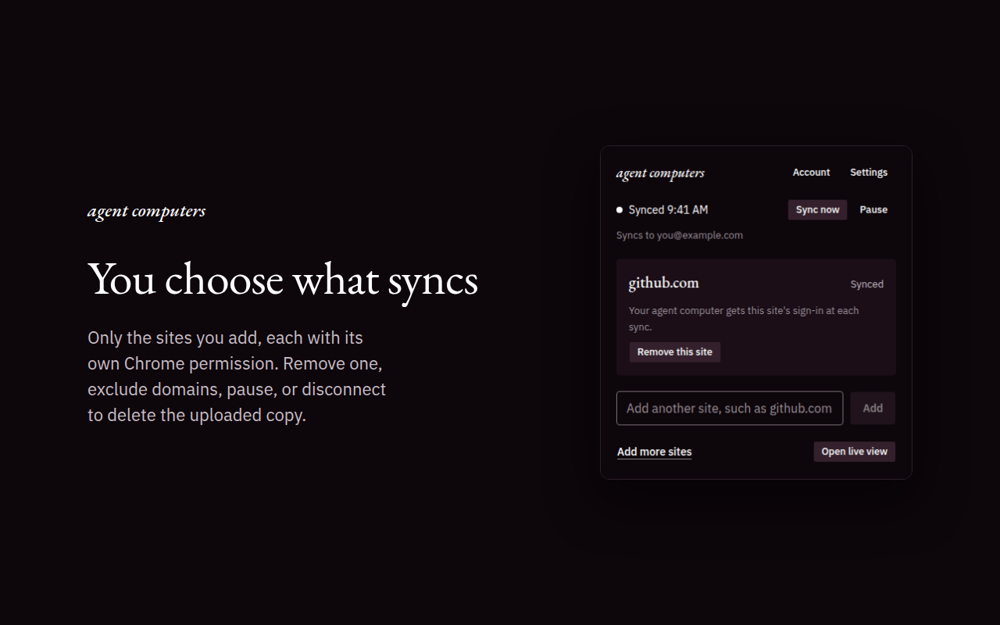

# Agent Computers browser extension

The Chrome extension (Manifest V3) that keeps your agents signed in to the sites you choose. It captures those sites' cookies with their full metadata and syncs them, one way, to your server: [`apps/server`](../server) when you self-host, or [agent-computers.com](https://www.agent-computers.com) from the [Chrome Web Store](https://chromewebstore.google.com/detail/agent-computers-%E2%80%94-browser/bjmfpnkjkdkfimdfgbgepmdgdnodpmmi).



- **Only the sites you add,** each behind its own Chrome permission; it requests no host permissions at install. Builds outside the Chrome Web Store also offer **Allow all sites**, as an explicit choice.
- **Excluded domains** are never captured, even under Allow all sites.
- **Pause, remove a site, or disconnect** at any time. Disconnecting deletes what this browser uploaded.
- **Uploads only on change,** in the background while Chrome runs, over OAuth with PKCE and short-lived tokens.

Works in Chrome 130 and later, and in other Chromium browsers (Edge, Brave, Arc).

## Build it for your server

```sh
bun install
WXT_SERVER_ORIGIN=https://sync.example.com bun run build:extension
```

Load `apps/extension/.output/chrome-mv3` unpacked from `chrome://extensions` (Developer mode), or pack it with your own key and force-install it with Chrome Enterprise policy. `bun run dev:extension` starts a development build that reloads on change.

To publish a modified build, on a store or anywhere else, give it its own name and icons (`wxt.config.ts` and `public/icon`) and your own key: the Agent Computers name and icons mean this project's builds ([trademark policy](../../TRADEMARKS.md)).
